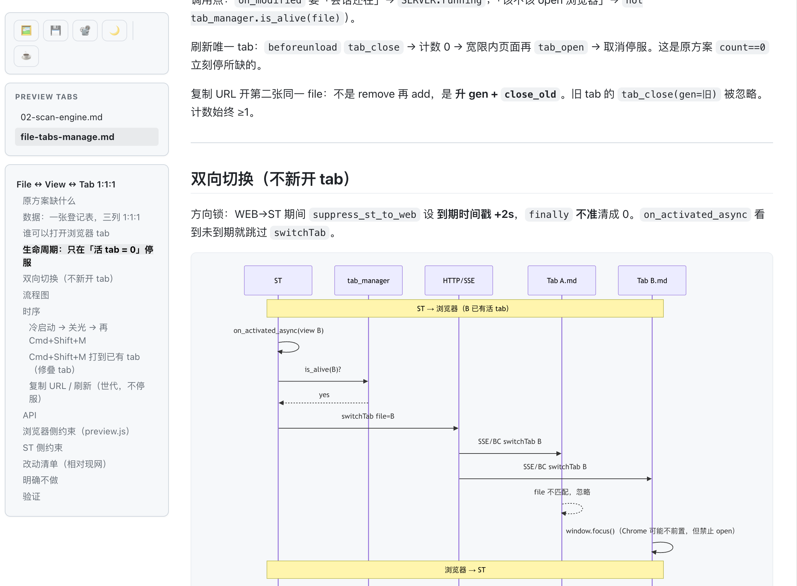

# MarkdownPreviewEnhanced

[English](README.md) | **中文**

Sublime Text 4 的浏览器实时 Markdown 预览。零额外依赖。



## 功能

| 预览 | Markdown |
| --- | --- |
| ✅ 浏览器实时预览 | ✅ GitHub 风格 HTML / CSS |
| ✅ SSE 原地更新（不刷新） | ✅ 代码高亮 |
| ✅ 一文件一预览 tab | ✅ GFM 任务列表 |
| ✅ 编辑器 ↔ 预览 tab 互切 | ✅ 脚注 |
| ✅ 滚动同步（编辑器 ↔ 预览） | ✅ GFM emoji（`:smile:`） |
| ✅ 目录 + 预览 tab 列表 | ✅ YAML frontmatter（标题 / 日期 / 标签顶栏） |
| ✅ 演示模式（16:9 幻灯片，分页 + 备注） | ✅ KaTeX（`$…$` / `$$…$$`） |
| ✅ 暗色模式（跟随系统，可记住） | ✅ Mermaid 图（点击放大） |
| ✅ 复制为富文本（📋 / 命令） | ✅ ECharts |
| ✅ 粘贴为 markdown（右键 / 命令，HTML + 截图） | ✅ Callout 提示块（`> [!NOTE]`） |
| ✅ 代码块复制按钮 | ✅ `~~删除~~` `==高亮==` `^上标^` `~下标~` |
| | ✅ 代码块文件名 / 行号 / 高亮行 |
| ✅ 相对路径图片（`./img/a.png`） | ✅ 任务列表 checkbox 预览点击回写 |
| ✅ 导出 HTML / PNG / PDF | ✅ 图片点击放大 |
| ✅ 自定义 CSS 和 favicon | ✅ 零额外依赖 |
| ✅ macOS / Windows / Linux | |

## 安装

命令面板 → `Package Control: Install Package` → `MarkdownPreviewEnhanced`

或把本仓库克隆到 `Packages/MarkdownPreviewEnhanced/`（仓库根目录就是包根目录）。

## 用法

打开 `.md` 文件后，从命令面板运行 **MarkdownPreviewEnhanced: Toggle Preview** 打开 / 聚焦预览。本包**不默认绑定任何快捷键**（不覆盖 Sublime 内置快捷键 —— [issue #11](https://github.com/CaffeineOddity/MarkdownPreviewEnhanced/issues/11)）；需要快捷键见下方 [快捷键](#快捷键)。

- **粘贴为 markdown**（右键或命令面板）把剪贴板 HTML 转为 markdown（标题、粗斜体、链接、列表、代码块、GFM 表格）；无 HTML 则降级为普通粘贴。Linux 需 `xclip` / `wl-clipboard`。设 `paste_download_images` 为 `true` 可把远程图片存到 `media/`。
- 编辑时浏览器原地更新（SSE），滚动位置保留。再按一次命令聚焦已有标签。浏览器切预览 tab ↔ Sublime 切 view。只要还有预览 tab，本地服务器就保持；全关后很快停服。
- 侧栏工具条：📋 复制为富文本、🖼️ PNG、💾 独立 HTML、📽️ 演示、🌙/☀️ 暗色、☕ tip。
- 右下角 👁️ 按钮可隐藏 / 显示整条侧栏（工具条、tabs、目录），专注看正文；选择会被记住。
- 悬停代码块出现 **Copy** 按钮。**复制为富文本**把渲染 HTML 放剪贴板（浏览器按钮或命令面板），可粘贴进邮件 / Word / Confluence。
- 暗色默认跟随系统，切换后记在浏览器。点击 Mermaid 图或图片放大。在 Sublime 点某行，预览滚到对应块中间。
- GFM 任务列表 checkbox 可点击并回写源文件。Callout（`> [!NOTE]` / `TIP` / `IMPORTANT` / `WARNING` / `CAUTION`）、`~~删除~~`、`==高亮==`、`^上标^`、`~下标~` 在预览与导出中均可渲染。

### 演示模式

📽️ 或命令 **MarkdownPreviewEnhanced: Presentation Mode**。幻灯片复用实时预览渲染；每个 `h1`–`h4` 开一页。16:9 画布，方向键 / 边缘点击 / HUD 翻页。

## 快捷键

本包**不默认绑定任何快捷键**（[issue #11](https://github.com/CaffeineOddity/MarkdownPreviewEnhanced/issues/11)），需要请自行绑定：

- 命令面板(command + shift + p) → 输入KeyBindings,选择**Preferences: MarkdownPreviewEnhanced Key Bindings** 打开双栏视图：左栏示例、右栏 `User` keymap；保存右栏生效。
- 或粘到 `User` keymap：

```json
[
    { "keys": ["super+alt+m"], "command": "markdown_preview_enhanced_toggle" },
    { "keys": ["super+alt+v"], "command": "markdown_preview_enhanced_paste_as_markdown" },
    { "keys": ["super+alt+p"], "command": "markdown_preview_enhanced_insert_pagebreak" },
    { "keys": ["super+alt+n"], "command": "markdown_preview_enhanced_insert_notes" }
]
```

Windows / Linux 把 `super` 换成 `ctrl`。`super+alt` / `ctrl+alt` 避开了内置 **Expand Selection to Brackets** / **Paste and Indent**（它们占着 `super+shift+m` / `super+shift+v`）。其余命令在命令面板 `MarkdownPreviewEnhanced:` 前缀下。

## 设置

Preferences → Package Settings → **MarkdownPreviewEnhanced** → Settings

| 设置 | 默认 | 说明 |
| --- | --- | --- |
| `mermaid_theme` | `"default"` | 导出 / 文件模式：`default` / `dark` / `forest` / `neutral`。实时预览跟随页面明暗。 |
| `output_dir` | `""` | 空 = Sublime 缓存目录 |
| `use_local_server` | `true` | SSE、相对图片、滚动同步 |
| `server_port` | `8765` | 占用时会尝试后续端口 |
| `server_idle_seconds` | `0` | 空闲自动停服；`0` = 直到 Close / 退出 Sublime |
| `browser` | `"auto"` | `auto` / `chrome` / `safari` / `firefox` / `edge` / … |
| `debounce_ms` | `500` | 输入时的重渲染延迟 |
| `show_toc` | `true` | 目录侧栏 |
| `enable_katex` | `true` | `$...$` / `$$...$$` |
| `enable_emoji` | `true` | GFM emoji shortcode（`:smile:`） |
| `enable_task_lists` | `true` | `- [ ]` / `- [x]` |
| `enable_footnotes` | `true` | `[^1]` |
| `strip_frontmatter` | `true` | 去掉文首 YAML `---` |
| `scroll_sync` | `true` | 编辑器 ↔ 预览（需要本地服务器） |
| `paste_download_images` | `false` | 粘贴为 markdown：把远程图片下载到 `media/` |
| `paste_images_dir` | `"media"` | 下载图片子目录（相对 md 文件） |
| `custom_css` | `""` | 额外 CSS 路径（可用 `~`） |
| `embed_images` | `true` | 导出 HTML/PDF：本地图内嵌 base64，产物单文件可移植 |
| `favicon` | `""` | 空 = 包内默认图标；`"none"` = 不要图标；否则填本地路径或 `http(s)` URL |

单视图覆盖：

```jsonc
{
    "markdown_preview_enhanced.mermaid_theme": "forest"
}
```

需要 Sublime Text 4（Build 4107+）。公式、图表、高亮都已内置，不用再装别的。

二次开发 / PR：[CONTRIBUTING.md](CONTRIBUTING.md)

## 赞助

觉得有用可以请杯咖啡：

- [Buy Me a Coffee](https://buymeacoffee.com/caffeineoddity)
- 微信赞赏：

<p></p>

## 许可

MIT — [LICENSE](LICENSE)
