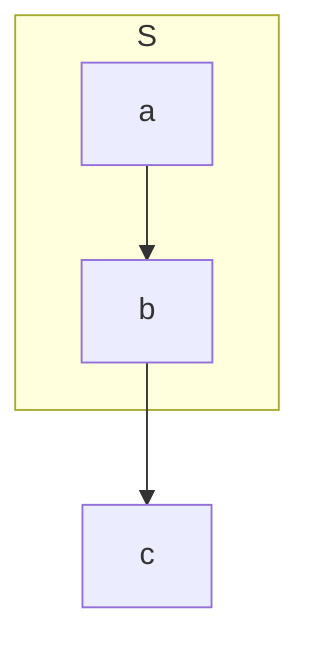

# Issue 验证用例集

> 每条 issue 一节：现象 → 自动回归 → 手动用例 → 结果记录。
> 手动用例在本文件预览里点击验证；规格见 [link-fragment-anchor](./specs/link-fragment-anchor.md)，回归测试见 `tests/test_link_fragment_anchor.py`。

## Issue #22：跨文件标题链接 404

- 现象：[链接到另一个文件的标题](../README_zh.md#功能) 打开 404（`/doc/...md#heading` → "Nothing matches the given URI"）
- 根因：`mpe_core/md_renderer.py` 的 `rewrite_link_hrefs()` 把 `#fragment` 当文件名的一部分，`.md` 判断与存在性探测都失败，落到 `/doc/` 分支后被 `../` 钳制到根；`assets/preview.js` 的 `switchToPreview()` 只带 `?file=`，丢 fragment。
- 修复：服务端先摘 fragment 再解析路径、原样拼回重写后的 URL；客户端把 fragment 带到 `window.open`，并在内容渲染后滚到对应 id。
- 关联文档：[link-fragment-anchor](./specs/link-fragment-anchor.md)、[file-tabs-manage](./file-tabs-manage.md)

### 自动回归

```bash
python3 tests/run_all.py
```

用例在 `tests/test_link_fragment_anchor.py`（12 条），覆盖：

| 用例 | 断言 |
|------|------|
| md + 中文 fragment | 重写为 `/?file=<abs>#字色`，无 `/doc/` |
| md + ASCII fragment | 重写为 `/?file=<abs>#hello-world` |
| md 无 fragment | 行为与修复前一致 |
| 同文档相对链接 | `/?file=<本文件>#字色` |
| 非 md 文件 + fragment | `/doc/notes.txt#L10` |
| 目录链接 + fragment | 落到目录入口文档 + fragment |
| 页内锚点 / 外链 | 原样不改写 |
| md 链接 | 不加 `target="_blank"` |
| 文件模式 | 整段 HTML 不变 |
| markdown 整链路 | `[字色](other.md#字色)` 渲染出 `/?file=<abs>#字色` |
| 目标标题 id | `## 字色` 渲染出 `id="字色"`（fragment 能对上） |

### 手动用例

前置：用命令面板 `MarkdownPreviewEnhanced: Toggle Preview` 打开本文件（server 模式，默认配置）。
每项都点一次链接；「期望」栏里地址栏指浏览器地址栏。

| # | 操作 | 期望 | 结果 |
|---|------|------|------|
| C1 | 点 [验收标准](./specs/link-fragment-anchor.md#验收标准)（跨目录 + 中文标题，issue 原始场景） | 打开 `docs/specs/link-fragment-anchor.md`，落地即滚到「验收标准」标题；地址栏 `?file=...link-fragment-anchor.md#验收标准`；无 404 | ☐ |
| C2 | 点 [link-fragment-anchor](./specs/link-fragment-anchor.md#link-fragment-anchor)（ASCII 标题） | 同上文件，滚到 H1 | ☐ |
| C3 | 点 [本页 Issue #22 一节](./issues_case_validate.md#issue-22跨文件标题链接-404)（同文档的跨文件写法） | 不新开 tab、不刷新，原地平滑滚到本节 | ☐ |
| C4 | 点 [link-fragment-anchor（无锚点）](./specs/link-fragment-anchor.md) | 正常打开文档，停在顶部（回归用例） | ☐ |
| C5 | 点 [回到标题](#issue-验证用例集)（页内锚点） | 原地平滑滚到本页标题（回归用例） | ☐ |
| C6 | 点 [README 功能一节](../README_zh.md#功能) | 打开 `README_zh.md` 并滚到「功能」（issue 标题场景） | ☐ |
| C7 | 点 [链接到不存在文件](./nope.md#heading) | 打开预览错误页而非 `/doc/` 404；不崩 | ☐ |
| C8 | 点 [百分号编码的锚点](./specs/link-fragment-anchor.md#%E9%AA%8C%E6%94%B6%E6%A0%87%E5%87%86) | 与 C1 相同，滚到「验收标准」 | ☐ |
| C9 | C1 落地后手动往下滚，回到编辑器改动本文件触发实时刷新 | 不被拉回标题位置（只自动滚一次） | ☐ |

补充检查：

- [ ] 导出 HTML（`MarkdownPreviewEnhanced: Export HTML`）产物中链接仍是相对路径且带 `#fragment`
- [ ] 浏览器地址栏把 C1 的链接复制出来，直接粘到新标签能打开同一标题（不依赖点击链路）

### 结果记录

| 日期 | 版本 | 结果 | 备注 |
|------|------|------|------|
| 2026-11-07 | 工作区改动（未发版） | 自动回归 12/12 通过；手动用例待执行 | 落地滚动（C1/C2/C8 路径）与同文档原地滚动（C3 路径）已在无头 Chrome harness 验证；C1~C9 仍需在 Sublime Text 内实测 |



