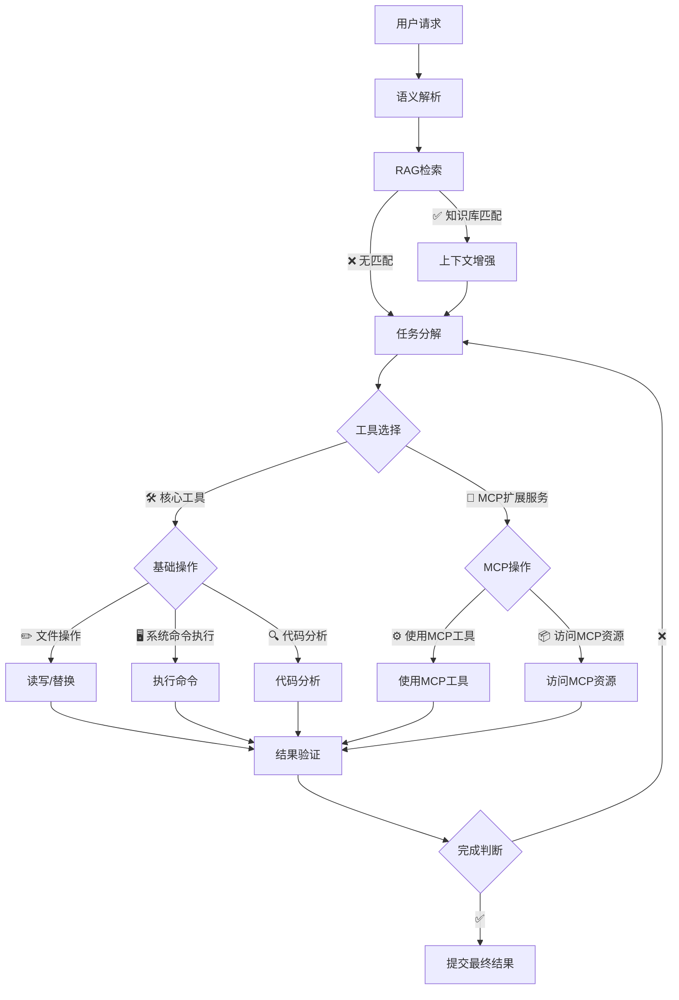
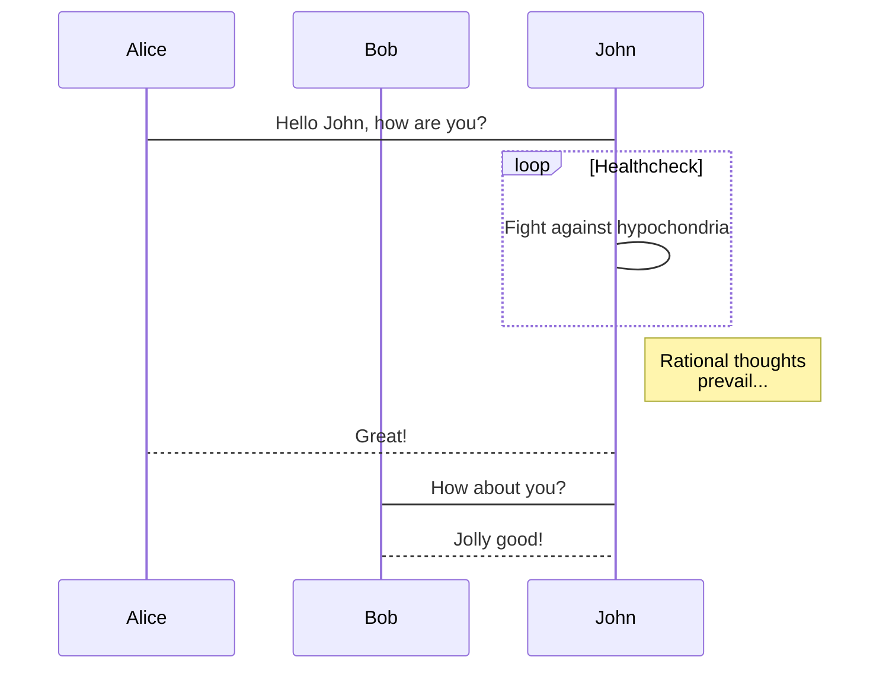
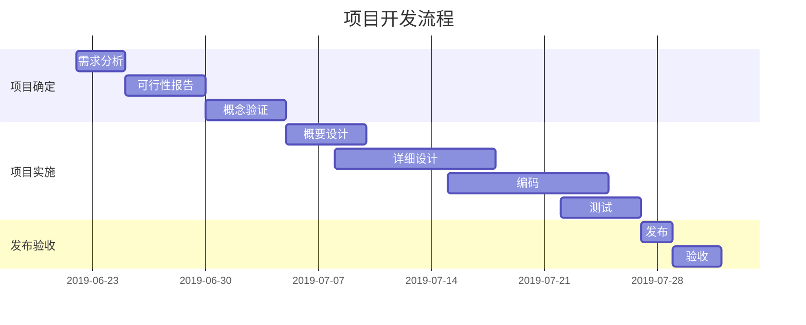
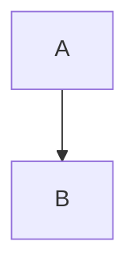
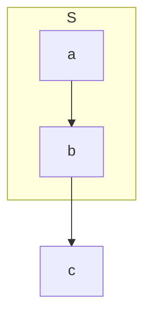

# 欢迎使用 `Arya` 在线 Markdown 编辑器

[Arya](https://markdown.lovejade.cn/?ref=markdown.lovejade.cn)，是一款基于 `Vue`、`Vditor`，为未来而构建的在线 Markdown 编辑器；轻量且强大：内置粘贴 HTML 自动转换为 Markdown，支持流程图、甘特图、时序图、任务列表，可导出携带样式的图片、PDF、微信公众号特制的 HTML 等等。

---

## 如何使用   

[重定向文档](./superpowers/specs/2026-07-07-markdown-preview-pro-design.md)
[file-tabs-manage.md](./file-tabs-manage.md)
[issue-sse-connection-hang.md](./issue-sse-connection-hang.md)

**微注**：清空目前这份默认文档，即处于可使用态。[Arya](https://markdown.lovejade.cn/?ref=markdown.lovejade.cn) 另一大优点在于：编辑内容只会在您本地进行保存，不会上传您的数据至服务器，**绝不窥测用户个人隐私，可放心使用**；Github 源码：[markdown-online-editor](https://github.com/nicejade/markdown-online-editor)，部分功能仍在开发🚧，敬请期待。

默认为[所见即所得](https://hacpai.com/article/1577370404903?ref=github.com)模式，可通过 `⌘-⇧-M`（`Ctrl-⇧-M`）进行切换；或通过以下方式：

- 所见即所得：`⌘-⌥-7`（`Ctrl-alt-7`）；
- 即时渲染：`⌘-⌥-8`（`Ctrl-alt-8`）；
- 分屏渲染：`⌘-⌥-9`（`Ctrl-alt-9`）；


### 句型

中文标题的 id 应与文本一致，内部链接才能滚动到位。

[跳到「语法要点」](#语法要点)　

### PPT 预览

如果您用作 `PPT` 预览（入口在`设置`中），需要注意，这里暂还不能支持各种图表的渲染；您可以使用 `---` 来定义水平方向上幻灯片，用 `--` 来定义垂直幻灯片；更多设定可以参见 [RevealJs 文档](https://github.com/hakimel/reveal.js#table-of-contents)。

---

## 什么是 Markdown

`Markdown` 是一种方便记忆、书写的纯文本标记语言，用户可以使用这些标记符号，以最小的输入代价，生成极富表现力的文档：譬如您正在阅读的这份文档。它使用简单的符号标记不同的标题，分割不同的段落，**粗体**、*斜体* 或者[超文本链接](https://vue-cli3.lovejade.cn/explore/)，更棒的是，它还可以：

---

```python
def _startupinfo():
    """Hide the console window when spawning subprocesses on Windows."""
    if sys.platform == "win32":
        si = subprocess.STARTUPINFO()
        si.dwFlags |= subprocess.STARTF_USESHOWWINDOW
        return si
    return None
```
### 1. 制作待办事宜 `Todo` 列表

- [x] 🎉 通常 `Markdown` 解析器自带的基本功能；
- [x] 🍀 支持**流程图**、**甘特图**、**时序图**、**任务列表**；
- [x] 🏁 支持粘贴 HTML 自动转换为 Markdown；
- [x] 💃🏻 支持插入原生 Emoji、设置常用表情列表；
- [x] 🚑 支持编辑内容保存**本地存储**，防止意外丢失；
- [x] 📝 支持**实时预览**，主窗口大小拖拽，字符计数；
- [x] 🛠 支持常用快捷键(**Tab**)，及代码块添加复制
- [x] ✨ 支持**导出**携带样式的 PDF、PNG、JPEG 等；
- [x] ✨ 升级 Vditor，新增对 `echarts` 图表的支持；
- [x] 👏 支持检查并格式化 Markdown 语法，使其专业；
- [x] 🦑 支持五线谱、及[部分站点、视频、音频解析](https://github.com/b3log/vditor/issues/117?ref=hacpai.com#issuecomment-526986052)；
- [x] 🌟 增加对**所见即所得**编辑模式的支持(`⌘-⇧-M`)；

---

### 2. 书写一个质能守恒公式[^LaTeX]

$$
E=mc^2
$$

---

### 3. 高亮一段代码[^code]

```js
// 给页面里所有的 DOM 元素添加一个 1px 的描边（outline）;
[].forEach.call($$("*"),function(a){
  a.style.outline="1px solid #"+(~~(Math.random()*(1<<24))).toString(16);
})
```

---

### 4. 高效绘制[流程图](https://github.com/knsv/mermaid#flowchart)



---

### 5. 高效绘制[序列图](https://github.com/knsv/mermaid#sequence-diagram)



---

### 6. 高效绘制[甘特图](https://github.com/knsv/mermaid#gantt-diagram)

> **甘特图**内在思想简单。基本是一条线条图，横轴表示时间，纵轴表示活动（项目），线条表示在整个期间上计划和实际的活动完成情况。它直观地表明任务计划在什么时候进行，及实际进展与计划要求的对比。



### 7. 支持图表

```echarts
{
  "backgroundColor": "#212121",
  "title": {
    "text": "「晚晴幽草轩」访问来源",
    "subtext": "2019 年 6 月份",
    "x": "center",
    "textStyle": {
      "color": "#f2f2f2"
    }
  },
  "tooltip": {
    "trigger": "item",
    "formatter": "{a} <br/>{b} : {c} ({d}%)"
  },
  "legend": {
    "orient": "vertical",
    "left": "left",
    "data": [
      "搜索引擎",
      "直接访问",
      "推荐",
      "其他",
      "社交平台"
    ],
    "textStyle": {
      "color": "#f2f2f2"
    }
  },
  "series": [
    {
      "name": "访问来源",
      "type": "pie",
      "radius": "55%",
      "center": [
        "50%",
        "60%"
      ],
      "data": [
        {
          "value": 10440,
          "name": "搜索引擎",
          "itemStyle": {
            "color": "#ef4136"
          }
        },
        {
          "value": 4770,
          "name": "直接访问"
        },
        {
          "value": 2430,
          "name": "推荐"
        },
        {
          "value": 342,
          "name": "其他"
        },
        {
          "value": 18,
          "name": "社交平台"
        }
      ],
      "itemStyle": {
        "emphasis": {
          "shadowBlur": 10,
          "shadowOffsetX": 0,
          "shadowColor": "rgba(0, 0, 0, 0.5)"
        }
      }
    }
  ]
}
```

> **备注**：上述 echarts 图表📈，其数据，须使用严格的 **JSON** 格式；您可使用 JSON.stringify(data)，将对象传换从而得标准数据，即可正常使用。

---
### 8. 绘制表格

| 作品名称        | 在线地址   |  上线日期  |
| :--------  | :-----  | :----:  |
| 逍遥自在轩 | [https://www.niceshare.site](https://www.niceshare.site/?ref=markdown.lovejade.cn) |2024-04-26|
| 玉桃文飨轩 | [https://share.lovejade.cn](https://share.lovejade.cn/?ref=markdown.lovejade.cn) |2022-08-26|
| 缘知随心庭 | [https://fine.niceshare.site](https://fine.niceshare.site/?ref=markdown.lovejade.cn) |2022-02-26|
| 静轩之别苑 | [http://quickapp.lovejade.cn](http://quickapp.lovejade.cn/?ref=markdown.lovejade.cn) |2019-01-12|
| 晚晴幽草轩 | [https://www.jeffjade.com](https://www.jeffjade.com/?ref=markdown.lovejade.cn) |2014-09-20|

---

### 9. 更详细语法说明

想要查看更详细的语法说明，可以参考这份 [Markdown 资源列表](https://github.com/nicejade/nice-front-end-tutorial/blob/master/tutorial/markdown-tutorial.md)，涵盖入门至进阶教程，以及资源、平台等信息，能让您对她有更深的认知。

总而言之，不同于其它**所见即所得**的编辑器：你只需使用键盘专注于书写文本内容，就可以生成印刷级的排版格式，省却在键盘和工具栏之间来回切换，调整内容和格式的麻烦。**Markdown 在流畅的书写和印刷级的阅读体验之间找到了平衡。** 目前它已经成为世界上最大的技术分享网站 `GitHub` 和 技术问答网站 `StackOverFlow` 的御用书写格式，而且越发流行，正在在向各行业渗透。

最新更新于 2025.04.16

---

## 回归测试（v0.3.x 修复项）

### 1. 有序列表起始编号（start 属性）

列表被段落打断后，起始编号应当保留，而不是从 1 重新开始。

5. 第五项（本列表应从 5 开始，显示 5、6，而不是 1、2）
6. 第六项

换个起点：

3. 从 3 开始（应显示 3、4）
4. 第四项

从 1 开始的列表保持默认（不应多出 start 属性）：

1. 第一项
2. 第二项

### 2. 代码块：行号列 + 语法高亮 + 头部复制按钮

普通代码块应有独立行号列、语法高亮，头部展示语言名和 Copy 按钮。

```python
def greet(name):
    # 注释应当高亮
    return f"Hello, {name}!"  # 字符串应当高亮
```

带文件名与行高亮的代码块（高亮第 1 行和第 3-5 行）：

```python title="greet.py" {1,3-5}
def greet(name):
    return f"Hello, {name}!"
    for i in range(3):
        print(i)
    print("done")
```

Shell 代码块，Copy 按钮应固定在头部（不要压在第一行代码上）：

```shell title="build.sh" {1,2}
#!/usr/bin/env bash
set -euo pipefail
echo "building..."
make
```

### 3. 中文标题 anchor（issue #16）

中文标题应保留 Unicode 作为锚点 id，而不是退化成 `_1`/`_2`；点下面的链接能跳到对应标题。


### 语法要点

重复的中文标题会自动加 `_1` 后缀去重，不影响首个标题的链接。


[跳到「句型」](#句型)

---

### 4. Mermaid 标题 id 冲突（issue #18）

标题恰好生成 id 为 `mermaid` 时会占用浏览器全局名 `window.mermaid`，遮住真正的 mermaid 库。下面的图必须正常渲染成 SVG（不能停留在源码文本），且控制台不要出现 `mermaid.initialize is not a function`。

#### Mermaid



---

### 5. 子图外连边（issue #19）

子图里的节点连到外面时，子图自己的 `direction` 应被忽略。下面 `a`、`b` 应上下排列，连到 `c` 的边从节点 `b` 出发，而不是从子图 `S` 的边框出发。



---

### 6. 单换行是软换行（issue #21）

段内的单个换行应并进同一段，预览里不要断成两行。要强制断行，在行尾加两个空格。空行才是新段落。

This is a single sentence
that is written across two lines.

硬换行（上一行行尾有两个空格）：

first line  
second line

新段落：

one paragraph

another paragraph

---

### 7. 跨文件标题链接（issue #22）

链接到另一个文件的标题时，应打开那个文件并滚到对应标题，地址栏保留 `#fragment`，不要出现 `/doc/` 404。写成文件路径、但指向本文的链接，应在当前页原地滚动，不新开标签。没有锚点的链接停在文档顶部。目标文件不存在时，应打开预览错误页。落地后再改本文件触发刷新，不应被拉回标题。

跨目录、中文标题：

[验收标准](./specs/link-fragment-anchor.md#验收标准)

同一文件的英文标题：

[link-fragment-anchor](./specs/link-fragment-anchor.md#link-fragment-anchor)

同文档，但写成文件路径（应原地滚到本节）：

[本节](./issuses_case.md#7-跨文件标题链接issue-22)

没有锚点，停在文档顶部：

[link-fragment-anchor（无锚点）](./specs/link-fragment-anchor.md)

页内锚点：

[回到文首](#欢迎使用-arya-在线-markdown-编辑器)

README 里的标题：

[功能](../README_zh.md#功能)

目标文件不存在：

[不存在的文件](./nope.md#heading)

百分号编码的锚点，应和上面的「验收标准」落在同一标题：

[验收标准](./specs/link-fragment-anchor.md#%E9%AA%8C%E6%94%B6%E6%A0%87%E5%87%86)

### 8 Markdown render test (issue #23）
* List 1
  - nested list 1a
  - nested list 1b
* List 2
  - nested list 2a
  - nested list 2b
